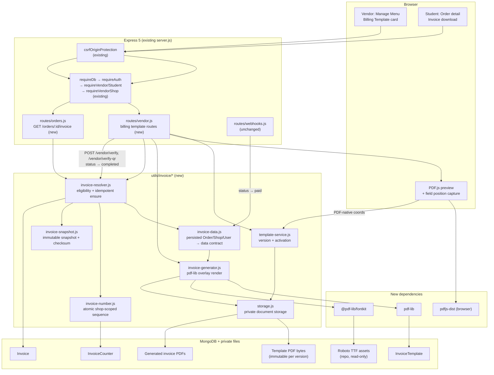
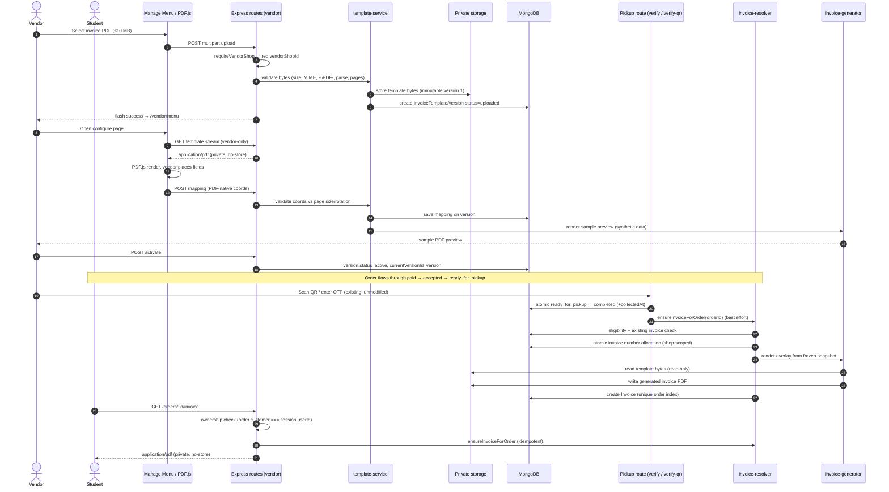

# 02 — System Architecture (PROPOSED)

All components in this file are **PROPOSED** unless marked EXISTING. No part of
this architecture exists in the application today.

Cross-references: locked rules in `00_PRODUCT_CONTRACT.md`, verified facts in
`01_CODEBASE_AUDIT.md`, rendering detail in `04_PDF_TEMPLATE_ENGINE.md`,
issuance detail in `05_INVOICE_DATA_AND_GENERATION.md`, storage/security in
`06_STORAGE_SECURITY_AND_INTEGRATION.md`, phases in `08_IMPLEMENTATION_PHASES.md`.

---

## 1. Component overview

Seven logical components, all inside the existing Express/EJS/Mongoose
application. No new framework, no client-side build toolchain, no separate
service.

| Component | Location (proposed) | Responsibility |
|---|---|---|
| **Template registry** | `models/InvoiceTemplate.js` | Shop-owned template, current pointer, immutable versions, field mapping, activation state |
| **Invoice registry** | `models/Invoice.js` | One document per order; number, snapshot, stored file keys, template version reference |
| **Number allocator** | `models/InvoiceCounter.js` + `utils/invoice/invoice-number.js` | Atomic per-shop sequence |
| **Document storage** | `utils/invoice/storage.js` | Private read/write of template PDFs, generated PDFs, previews (adapter boundary) |
| **Template service** | `utils/invoice/template-service.js` (proposed companion to the listed files) | Validation, version creation, activation, replacement, sample preview orchestration |
| **Render engine** | `utils/invoice/invoice-generator.js` + `invoice-data.js` + `invoice-snapshot.js` | Snapshot build, overlay render, checksum, persistence handoff |
| **Resolver** | `utils/invoice/invoice-resolver.js` | Eligibility decision + idempotent ensure/create |

The five filenames explicitly required by the specification are:

```text
utils/
  invoice/
    invoice-resolver.js
    invoice-data.js
    invoice-generator.js
    invoice-number.js
    invoice-snapshot.js
```

Additional files are allowed only when a phase needs them (for example
`utils/invoice/storage.js` and `utils/invoice/template-service.js` for the
storage adapter and the vendor template operations). Do not invent a parallel
`services/` layer.

### 1.1 Dependency direction (no cycles)

```text
routes/vendor.js ─┐
routes/orders.js ─┼─▶ utils/invoice/invoice-resolver.js
routes/invoice.js ─┘        │
                            ├─▶ utils/invoice/invoice-data.js
                            │        └─▶ models/Order, models/Shop, models/User
                            ├─▶ utils/invoice/invoice-number.js
                            │        └─▶ models/InvoiceCounter
                            ├─▶ utils/invoice/invoice-snapshot.js
                            └─▶ utils/invoice/invoice-generator.js
                                     ├─▶ utils/invoice/storage.js
                                     ├─▶ models/InvoiceTemplate
                                     ├─▶ pdf-lib, @pdf-lib/fontkit
                                     └─▶ utils/money.js, utils/discount.js
```

Rules:

- `utils/invoice/*` must not import `routes/*` (no route-service cycles). The
  existing `routes/admin.js → routes/vendor.js` import is the only sanctioned
  cross-route import; do not add another.
- Models never import utilities that import models.
- The browser PDF.js module (`public/js/billing-template-editor.js`, proposed)
  must not import server code.

---

## 2. Mermaid — component architecture



---

## 3. Vendor upload flow (PROPOSED)

```text
Vendor opens /vendor/menu
  → Billing Template card (after Pickup Slots, before Operating Hours)
  → chooses a PDF (≤ 10 MB)
  → POST multipart to a dedicated billing upload route
      middleware: requireDb, requireAuth, requireVendor, requireVendorShop,
                  dedicated PDF multer (memory or private disk), CSRF (existing global)
      steps:
        1. size + extension + MIME + %PDF- signature
        2. parse with pdf-lib (reject encrypted/malformed)
        3. structural checks (page count, page rotation, page size)
        4. create Template Version (status: uploaded) — original bytes stored privately, immutable
        5. redirect back to /vendor/menu with flash success
  → card shows "Uploaded — configure fields" state
```

Rejected uploads never create a version row or a stored file. The response is a
flash + redirect (page flow), matching existing upload conventions; JSON is
returned only when the client is an XHR (`req.accepts` best-match, as in
`POST /vendor/verify-qr`).

---

## 4. Template configuration flow (PROPOSED)

```text
Vendor opens the configuration page (one page per template version)
  → GET serves the version metadata + saved mapping (if any)
  → browser fetches the template PDF through an authenticated vendor-only
    stream route, renders it with PDF.js at a known scale
  → vendor clicks each field target and drags/resizes the item-table box
  → browser converts viewport coords → PDF user-space coords
    (viewport.convertToPdfPoint; see 04_PDF_TEMPLATE_ENGINE.md §4)
  → browser posts the mapping JSON (PDF-native coords only, plus page index,
    font sizes, alignments, row height, column definitions)
  → server validates every coordinate against page dimensions, rejects
    out-of-page/negative/NaN values, stores mapping on the version
  → server renders a Sample Preview PDF with synthetic data
  → vendor reviews preview → activates
```

Configuration is stored on **one template version**. Field mapping is never
per-order. A new upload creates a new version with an empty mapping
(re-configuration required), because coordinates from a different PDF cannot be
assumed valid.

---

## 5. PDF overlay flow (PROPOSED)

```text
generateInvoicePdf(snapshot, templateVersion):
  1. read template bytes from private storage (read-only)
  2. PDFDocument.load(bytes, { ignoreEncryption: false })
     → if encrypted/unsupported: fail closed (no invoice issued)
  3. registerFontkit(pdfDoc) (once per document)
  4. embed Roboto Regular/Medium/Bold (subset: false for reliable ₹)
  5. read mapping for the version (page index + PDF coords + sizes/alignments)
  6. for each mapped field:
       - format value from snapshot (dates in IST, ₹ formatting)
       - wrap if needed; draw with the correct font, size, alignment
  7. item rows: draw each billable line at column X positions, advancing by
     rowHeight; wrap description within its column width
  8. if rows exceed the configured page-1 capacity:
       - append continuation page(s) of the same page size
       - draw a minimal continuation header + columns (no template artwork)
  9. save() → Buffer; the original template buffer is never written
 10. return { bytes, pageCount, checksum }
```

The renderer is pure: input = snapshot + template bytes + mapping, output =
PDF bytes. It touches no database and no HTTP objects, which is what makes it
unit-testable.

---

## 6. Order data preparation (PROPOSED)

```text
buildInvoiceData(order, shop, customer, templateVersion, options):
  - inputs are persisted documents only (Order, Shop, User)
  - converts rupee fields with utils/money.toPaise and formats for display
  - filters item.status === "removed" out of billable lines
  - computes foodSubtotalPaise by summing persisted unit price × quantity
  - uses persisted discountPercent/discountAmountPaise (never recomputed from
    a live shop discount, which may have changed)
  - uses persisted parcelCharge only when orderType === "parcel"
  - payablePaise = toPaise(order.total)  (post-adjustment authoritative value)
  - reconciliation (must pass or generation fails):
        foodSubtotalPaise - discountPaise + parcelPaise === payablePaise
    with the documented tolerance policy in 05_INVOICE_DATA_AND_GENERATION.md §6
  - when adjusted: include originalTotal/updatedTotal/refundAmount/refundStatus
    and removed item names as metadata
  - returns a plain, frozen data object (no Mongoose documents, no getters)
```

No value comes from the request body.

---

## 7. Invoice generation, issuance and persistence (PROPOSED)

```text
ensureInvoiceForOrder(orderId):
  1. load order (lean) → must exist
  2. eligibility (invoice-resolver):
       status === "completed"
       collectedAt != null
       amountChargedPaise finite > 0  OR  paymentNote === "mock"
       toPaise(order.total) finite > 0
     else → { ok:false, reason } (no record created)
  3. existing invoice? → return it (idempotent fast path)
  4. active template version for order.shop? → else { ok:false, reason:"no_template" }
  5. build snapshot (frozen) — includes templateVersionId, mapping hash,
     money values, item lines, metadata
  6. allocate invoice number (atomic per shop) — only after the snapshot and
     render prereqs are known
  7. render PDF (generator) → bytes + checksum
  8. store bytes privately (key derived from invoice id + hash)
  9. Invoice.create({ order, shop, customer, number, snapshot, file keys,
                      checksum, templateVersion, issuedAt })
     unique index on { order: 1 } → duplicate key = another request won;
     return that record instead
 10. on any failure after numbering: mark the record/attempt failed and record
     the reason; never leave a number attached to no invoice silently
```

**Trigger points (PROPOSED):**

- Best-effort generation immediately after a successful atomic completion in
  `POST /vendor/verify` and `POST /vendor/verify-qr`. Wrapped so a rendering or
  storage failure **cannot** fail the pickup response (the pickup must still
  succeed).
- **Lazy ensure** on the student invoice download route and on the vendor
  invoice view, so a missed background attempt self-heals without a second
  invoice.

Both paths call the same `ensureInvoiceForOrder`, which is why idempotency must
live in the resolver + unique index, not in the route.

---

## 8. Student download flow (PROPOSED)

```text
GET /orders/:id/invoice
  middleware: requireDb, requireAuth, requireStudent
  1. validate ObjectId → invalid: flash + redirect /orders
  2. load order; if missing or String(order.customer) !== String(session.userId)
       → flash "Order not found." + redirect /orders   (same as GET /orders/:id)
  3. ensureInvoiceForOrder(order._id)
       - no active custom template → no invoice is generated; the student keeps
         the existing default order bill (§10). Return the existing order page
         with an explanatory flash; create no record and no number.
       - eligible order with an active template → issue or return the invoice
       - not eligible → no invoice; explain that a custom invoice is issued only
         after collection (only reachable when a template is active)
  4. stream stored PDF: Content-Type application/pdf, Content-Length,
     Content-Disposition inline/attachment with a safe filename,
     Cache-Control: private, no-store, X-Content-Type-Options: nosniff
```

The order-detail page shows the download control only when an **actual custom
invoice exists**; it never links to a file path and never replaces the default
bill. The existing default order bill in `views/orders/show.ejs` remains the
billing experience for shops without an active custom template.

---

## 9. Template versioning (PROPOSED)

```text
InvoiceTemplate (one per shop)
  ├─ shop (unique index)
  ├─ currentVersionId (nullable)
  ├─ versions: [ embedded subdocuments ]   ← see model options in 06 §9
  │     version: integer (1,2,3…)
  │     originalFileKey, originalFileName, byteSize, sha256,
  │     pageCount, pageSizes[], encryptedFlag(always false when accepted)
  │     mapping { pageIndex, fields{}, itemTable{}, versionOfMapping }
  │     status: "uploaded" | "configured" | "previewed" | "active" | "superseded"
  │     createdAt, activatedAt, supersededAt
  └─ updatedAt
```

Rules:

- A version is **immutable** once created, except its `mapping` (until
  activation) and its `status`.
- Activation makes exactly one version `active` for the shop; the previous one
  becomes `superseded` but its stored bytes **remain** so historical invoices
  can be re-rendered/read.
- Every `Invoice` stores `templateVersionId` + `templateSha256` + `mappingHash`
  so an issued invoice is traceable to the exact bytes and coordinates used.
- Replacement = new version, not mutation. Removal = set `currentVersionId:null`,
  mark the active version `inactive`/`superseded`; files are retained
  (DECISION-8 governs deletion).

---

## 10. Fallback behavior (PROPOSED)

**The fallback is the existing HTML order-detail bill (`views/orders/show.ejs`),
not a PDF.** No generic FlashFoods invoice/receipt PDF is generated in any row
below, and the default bill is never hidden or replaced.

| Situation | Student-facing behavior | Custom invoice generated? |
|---|---|---|
| Shop has no template (never uploaded) | Existing default order bill unchanged: items, quantities, line amounts, parcel charge, total, status, progress tracker, pickup OTP/QR | No |
| Template uploaded but unconfigured / not activated | Existing default order bill unchanged; vendor card shows the incomplete mapping | No |
| Template removed | Existing default order bill unchanged; already-issued invoices remain downloadable | No (new ones) |
| Order not yet collected (`paid`/`accepted`/`ready_for_pickup`) | Default bill with normal tracking; no download action. A direct `/orders/:id/invoice` request explains the invoice is issued after collection | No |
| Order cancelled | Default bill showing the cancelled state; no download action | No |
| Payment evidence missing / eligibility failed | Default bill; failure reason logged for the final report; no fake numbers | No |
| Active template + eligible `completed` order | Default bill stays; a download action for the custom PDF is added | Yes, once |
| Rendering failure (corrupt template, missing font) | Default bill unaffected; vendor card surfaces an error; retry is safe later | No |
| Storage write failure | Default bill unaffected; retry is safe because issuance is idempotent | No |
| Template replaced mid-flight | Default bill unaffected; the snapshot pins the version active when the snapshot was built | Yes, from the pinned version |
| Order completed before the shop activated a template | Default bill until the order is resolved on demand; no bulk backfill | Only on demand, once, if eligible |
| Invoice record exists but its PDF file is missing | Download reports the inconsistency; default bill unaffected | Already issued — **do not** regenerate silently with another version; only from the recorded snapshot + version bytes |

Removal is not a billing outage: the default bill already covers every order,
so no shop state leaves a student without a billing view.

---

## 11. Mermaid — sequence diagram (upload → configure → collect → download)



---

## 12. Boundary rules

1. **Pickup code paths** may gain exactly one non-blocking call (or one
   post-response best-effort call) after the atomic completion. They must not
   gain new statuses, new buttons, new redirects, or new failure modes.
2. **Payment code paths** are not modified at all. Invoice eligibility reads
   persisted fields only.
3. **Vendor menu** gains one card and one new local; existing cards, forms, JS
   and API URLs stay intact.
4. **Student order detail** gains a download control only when a custom invoice
   exists; the default bill, polling, layout and ownership behavior stay intact.
5. **CSRF/session/auth** remain the existing implementations; billing routes are
   registered under the same global middleware stack.
6. **No new static public directory** for documents. Only the PDF.js worker and
   the editor script may live under `public/`; PDF documents may not.
