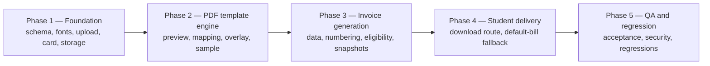

# 08 — Implementation Phases (PROPOSED execution plan)

Dependency-ordered plan. The implementing agent must not skip a phase gate, must
not begin a dependent phase before its dependencies pass, and must not weaken
acceptance criteria to advance.

Authority: `.ai/ORCHESTRATOR.md` (phase selection/advancement),
`.ai/rules.md` (mandatory constraints, no Git operations), and
`.ai/test.md` (safe test surfaces). Product rules:
`00_PRODUCT_CONTRACT.md`. Evidence format: `07_TESTING_AND_ACCEPTANCE.md` §10.

---

## 0. Phase graph



Rules:

- Phase 2 cannot start until a template can be uploaded, stored, re-read and
  rendered by PDF.js.
- Phase 3 cannot start until coordinate mapping and overlay rendering are proven
  with a sample invoice.
- Phase 4 cannot start until an invoice can be generated and persisted.
- Phase 5 is the only phase allowed to declare the feature complete.

Every phase ends with: focused tests executed, acceptance criteria observed,
`.ai/STATUS.md` updated with commands/results, then advancement.

---

## Phase 1 — Foundation

**Goal:** a vendor can upload a validated PDF, it is stored privately as an
immutable template version, and the Manage Menu card exists with correct state.

### Dependencies

- None (first phase), but requires the audit in `01_CODEBASE_AUDIT.md` to be
  re-verified against live code.

### Files likely to change

```text
package.json / package-lock.json            add pdf-lib, @pdf-lib/fontkit, pdfjs-dist
build-scripts/vendor-pdfjs.js               NEW (worker copy), wired into postinstall/build
public/vendor/pdfjs/pdf.worker.min.mjs      generated, not hand-edited
assets/fonts/Roboto/{Regular,Medium,Bold}.ttf NEW
assets/fonts/Roboto/LICENSE.txt, NOTICE.md   NEW
models/InvoiceTemplate.js                   NEW
models/InvoiceCounter.js                    NEW (number allocator; used in Phase 3)
models/Invoice.js                           NEW (schema only; writes in Phase 3)
utils/invoice/storage.js                    NEW (private storage adapter)
utils/invoice/invoice-validate.js           NEW (PDF validation gates)  [name may vary]
middleware/billingUpload.js                 NEW (dedicated PDF multer)
routes/vendor.js                            + upload/card data loading (minimal)
views/partials/menu-manager.ejs             + Billing Template card (after Pickup Slots)
views/vendor/billing-template.ejs           NEW (upload/status page) if not all in card
views/vendor/billing-template-configure.ejs NEW (Phase 2, placeholder in Phase 1)
.gitignore                                  + storage/
.eslint/prettier config                     none exists — do not add tooling
tests/unit/invoice-*.test.js                NEW
```

### Work units

1. **Dependency install + worker pipeline.** Add the three packages, create
   `build-scripts/vendor-pdfjs.js`, run the build, verify the worker is served
   and version-matched (VERIFY V8 in `06_...md` §13).
2. **Roboto assets + licence + hashes.** Add three TTFs, LICENSE, NOTICE with
   sha256. Unit test: files exist, parse, contain `₹`, hashes match.
3. **Schema design.** `InvoiceTemplate` (shop unique, versions array, statuses,
   mapping per version), `InvoiceCounter` (shop unique, seq), `Invoice`
   (order unique, number unique, snapshot, file keys, template refs, issuedAt,
   indexes). No changes to `Shop`/`Order` (Option A in `06_...md` §9).
4. **Storage adapter.** Private root from `BILLING_STORAGE_DIR` (default
   `./storage`), atomic writes, traversal guard, namespaced keys, sha256.
   Excluded from static serving and from git.
5. **Upload validation + middleware + route.** Implement §1 gates from
   `06_...md`, the dedicated multer, the POST route with
   `requireDb, requireAuth, requireVendor, requireVendorShop`, flash+redirect
   errors, and version creation on success.
6. **Vendor card.** Add the Billing Template card to
   `views/partials/menu-manager.ejs` between Pickup Slots and Operating Hours,
   gated by a new local; pass state from `GET /vendor/menu`. Implement states
   `none/uploaded/active/error` (configured state arrives in Phase 2).
7. **Authority checks.** For every new route: scope by `req.vendorShopId`, and
   prove student/vendor-other-shop access fails.

### Acceptance criteria

- Valid clean PDF ≤ 10 MB uploads and produces exactly one template version with
  stored bytes and a recorded sha256.
- Every invalid case in `06_...md` §1.2 is rejected with its reason code, and no
  version/file is created.
- Stored template bytes are byte-identical to the upload (sha256 compare).
- Templates are not reachable by any `public/` URL; no path is served statically.
- The card appears in the correct position for a vendor, is absent on admin menu
  pages, and shows accurate state after upload.
- Existing vendor menu cards and forms still work unchanged (regression).
- No dependency other than the three PDF packages was added.

### Tests

- U17 (font missing), U16 (validation reason codes), plus a new
  validation-reason unit table.
- I1–I10 (upload integration) where achievable without Phase 2 UI.
- `npm test` full unit suite green.
- A focused browser check of `/vendor/menu` at 393×852 and 1440×900 (card
  placement, no layout regression).

### Completion evidence

Commands and outputs for: install, build worker, unit suite, harness upload
tests, the browser check, and the file/DB inspection proving private storage and
sha256 equality.

### Failure/blocking conditions

- Any PDF library cannot be installed or its worker cannot be served locally →
  BLOCKED (do not substitute a CDN).
- Roboto assets cannot be obtained under a redistributable licence → BLOCKED for
  invoice generation; do not ship a different font.
- Storage root cannot be made private (for example, it is force-served) →
  BLOCKED (never serve PDFs from `public/`).
- Any existing vendor menu regression → stay in Phase 1 and fix.

---

## Phase 2 — PDF template engine

**Goal:** the vendor previews their own PDF, configures every field once, sees a
sample invoice, and activates the template. Rendering uses Roboto and preserves
the original design.

### Dependencies

- Phase 1 complete (template stored, storage adapter, card, fonts).

### Files likely to change

```text
utils/invoice/invoice-generator.js          NEW (overlay renderer)
utils/invoice/invoice-mapping.js            NEW (validate/normalize/hash mapping) [name may vary]
utils/invoice/invoice-format.js             NEW (money/date/words formatters) [or split]
views/vendor/billing-template-configure.ejs NEW (PDF.js editor)
public/js/billing-template-editor.js        NEW (PDF.js, coordinate conversion)
public/styles.css                           + scoped editor styles (vendor only, no global restyle)
routes/vendor.js                            + config/stream/mapping/sample/activate/remove routes
tests/unit/invoice-render*.test.js          NEW
tests/fixtures/billing/*.pdf                NEW
```

### Work units

1. **Mapping schema + server validation.** PDF-native coords, page index, field
   boxes, item-table columns, row height, alignment, sizes, `maxRowsFirstPage`,
   continuation config, tax mode, constants. Reject NaN/negative/out-of-page/
   overlapping-required/out-of-range. Canonical JSON + hash.
2. **PDF.js preview page.** Authenticated template stream, local worker,
   fit-width render, page nav, zoom, resize handling, cleanup.
3. **Coordinate capture.** CSS→viewport normalization,
   `viewport.convertToPdfPoint`, baseline anchoring, baseline guide, save in PDF
   coords only. Prove with a round-trip test (VERIFY V2).
4. **Roboto embedding in the renderer.** `registerFontkit`, three fonts,
   `subset: false` per §2/§6 of `04_...md`, font-missing fail-closed.
5. **Overlay renderer.** Field drawing (alignment/baseline), item table rows,
   wrapping/truncation, numeric columns, amount in words. No backgrounds, no
   masking, no drawn boxes.
6. **Overflow + continuation pages.** `maxRowsFirstPage`, appended pages,
   repeated columns, totals on last page, `layout_overflow` when unconfigured.
7. **Sample preview.** Real renderer with synthetic data, `SAMPLE` number, no
   counter use, no invoice record, served with private headers, required before
   activation.
8. **Activation / replacement / removal.** Atomic activation, mapping frozen on
   activation, new version for replacement, deactivation for removal, all
   shop-scoped.

### Acceptance criteria

- Preview shows the vendor's PDF unchanged (no re-layout, no re-render of the
  design, only a viewer + field guides).
- Saved mapping contains only PDF user-space coordinates and configuration; a
  reload restores exactly the same positions.
- Sample invoice renders with Roboto, correct alignment, `₹`, and amounts in
  words; sample contains no real invoice number.
- Activation fails without required fields, without a fresh sample for the
  current mapping hash, or with out-of-page coordinates.
- Activation freezes the mapping; further edits require a new version.
- Replacement keeps the previous version active until the new one is activated.
- Removal keeps files and does not delete anything.
- Template sha256 unchanged after any number of sample renders.
- The 120-character item name and `layout_overflow` cases behave per §8–§10 of
  `04_...md`.

### Tests

- R1–R13 (rendering), U11–U12 (mapping), I11–I19 (config/activation),
  V1–V3 verifications with recorded results.
- Browser: PDF.js render, field placement, save/reload, sample, activate,
  replace (Playwright items 1–6 in `07_...md` §8).

### Completion evidence

Sample PDF paths, measured render timings, the verification results for V1–V3,
mapping JSON snapshots (before/after reload), and the browser test output.

### Failure/blocking conditions

- `convertToPdfPoint` unavailable and no verified equivalent transform →
  BLOCKED until the transform is proven with a fixture.
- Fonts render `₹` as a missing glyph → BLOCKED (documented fallback in
  `00_PRODUCT_CONTRACT.md` §3 permits no substitute font).
- Overlay cannot preserve the template (for example the library mutates page
  content on save) → BLOCKED; do not switch to HTML/canvas rendering.
- Rotation/MediaBox-origin behavior cannot be handled safely → keep the upload
  rejection; do not "fix" by guessing.

---

## Phase 3 — Invoice generation and persistence

**Goal:** completing an eligible order issues exactly one invoice with a unique
number, an immutable snapshot, and a stored PDF.

### Dependencies

- Phase 2 complete (renderer + mapping proven with samples).

### Files likely to change

```text
utils/invoice/invoice-resolver.js           NEW (eligibility + idempotent ensure)
utils/invoice/invoice-data.js               NEW (persisted data → contract)
utils/invoice/invoice-number.js             NEW (atomic allocation + format)
utils/invoice/invoice-snapshot.js           NEW (freeze + hash + immutability helpers)
utils/invoice/invoice-generator.js          extend with final-mode persistence hooks
utils/invoice/storage.js                    extend invoice PDF write/read
models/Invoice.js                           finalize indexes + immutability guards
routes/vendor.js                            post-completion best-effort call (both pickup paths)
tests/unit/invoice-{data,number,snapshot,eligibility}*.test.js NEW
```

### Work units

1. **Data builder.** Implement `05_...md` §§2–6 exactly; no request data; no live
   menu/shop pricing; removed lines excluded; paise math via existing utilities;
   exact reconciliation; adjustment metadata.
2. **Tax configuration (conservative).** `taxMode: "none"` default;
   `inclusive_breakdown` optional with exact reconciliation; reject
   `exclusive_add`.
3. **Eligibility resolver.** All checks incl. `collectedAt`, payment evidence,
   payable > 0, active template, reconciliation. Named reasons.
4. **Invoice numbering.** `InvoiceCounter` `$inc` + upsert, shop-scoped, format
   function, gap tolerance documented, concurrency test.
5. **Snapshot.** Full contract + template/renderer/eligibility/output metadata;
   canonical hash; deep freeze; immutability guards.
6. **Generation pipeline.** Render → store bytes → allocate number → create
   `Invoice`; duplicate-key returns winner; failures leave no invoice and no
   number (ordering per `05_...md` §8.3).
7. **Completion integration.** Add best-effort `ensureInvoiceForOrder` after the
   atomic completion in `POST /vendor/verify` and `POST /vendor/verify-qr`;
   wrapped in try/catch; no change to responses, flash, redirect, handover JSON,
   or timing semantics. Re-verify no other completion path exists.
8. **Lazy ensure.** Same resolver used by Phase 4's download route (implemented
   here, exposed there).

### Acceptance criteria

- Eligible order → exactly one `Invoice`, one number, one stored PDF, one
  snapshot; payload reconciles to `order.total`.
- Ineligible orders (each reason) → no invoice, no number consumed.
- Concurrent/retried ensure → one invoice; no user-visible 500.
- Numbers unique and shop-scoped; 50 completions produce 50 unique numbers.
- Issued invoice cannot be mutated (guard test).
- Refunds/adjustments after issuance do not modify the snapshot or the file.
- Pickup responses byte-identical to pre-change behavior (regression).
- Payment flows untouched (no code change in `routes/orders.js` payment paths).

### Tests

- U1–U10, U13–U15, U16 partial, I20–I38 (issuance/idempotency/immutability),
  S1–S3, plus concurrency fixtures (10 parallel ensures, 50 numbers).

### Completion evidence

Test output, sample snapshot JSON (redacted of PII if shared), generated PDF
checksums, counter state, and the pickup regression comparison.

### Failure/blocking conditions

- Reconciliation fails on real persisted orders (legacy rounding) → investigate
  root cause; do not invoice mismatched totals and do not add tolerance without
  a documented decision.
- Payment evidence cannot be established for a gateway the shops actually use →
  exclude that path, record DECISION-7/related, and report.
- Numbering cannot be made atomic with the available MongoDB setup → BLOCKED
  (do not use `countDocuments` for numbering).
- Any change required in pickup semantics to trigger generation → BLOCKED; use
  lazy ensure instead.

---

## Phase 4 — Student delivery

**Goal:** when a custom invoice exists, the owning student downloads it from the
existing order detail with correct authorization and headers; shops without an
active custom template keep the existing default order bill unchanged.

### Dependencies

- Phase 3 complete (invoice generation/persistence proven).

### Files likely to change

```text
routes/orders.js                     + GET /orders/:id/invoice (ownership + ensure + stream)
routes/vendor.js                     + GET /vendor/orders/:id/invoice (optional vendor view)
views/orders/show.ejs                + download action only when a custom invoice exists (default bill unchanged)
public/styles.css                    + scoped portal styles for the control (mobile-only rules)
tests/unit or integration             + download authorization tests
```

### Work units

1. **Student download route.** `requireDb, requireAuth, requireStudent`, object
   id validation, ownership check identical to `GET /orders/:id`, ensure,
   stream with private headers, sanitized filename.
2. **Order-detail control.** Show a download action only when an actual custom
   invoice exists (or is issued for this eligible order within this request).
   Never show it for shops without an active template, never replace or restyle
   the default bill; no broken links; accessible label; 44 px target; mobile
   scoping; no desktop change beyond the added control.
3. **Default-bill fallback and messages.** No active template (never uploaded,
   uploaded-but-unconfigured, removed) → the existing default order bill stays
   and no invoice UI appears; only a direct invoice request gets an explanatory
   message. Not collected / cancelled / payment-unverified / render failure each
   get a distinct, honest message. No generic PDF is generated in any case.
4. **Vendor invoice view (optional but recommended).** Same generation path,
   shop-scoped.

### Acceptance criteria

- Owning student downloads a valid PDF; non-owner gets the existing
  "Order not found." behavior; unauthenticated users are redirected to `/login`.
- Vendor cannot use the student route; student cannot use the vendor route.
- Headers: `application/pdf`, correct length, `private, no-store`, `nosniff`.
- Shops without an active custom template show the existing default order bill
  unchanged; no invoice action, no PDF, no empty/error state.
- Control appears only when a custom invoice actually exists; no invoice UI for
  unpaid/cancelled/ineligible orders; layout intact at 393×852 and ≥768 px.
- Repeated downloads return identical bytes and never a second invoice.
- Mobile download works in the isolated browser harness.

### Tests

- I20–I25, I29, I30–I46 (download/authorization/headers/default-bill fallback),
  browser items 7–12, regression items for `/orders` polling and layout.

### Completion evidence

Route test output, header assertions, browser checks at both viewports, default-
bill evidence for the no-template / unconfigured / removed states, and the list
of fallback messages verified.

### Failure/blocking conditions

- Ownership cannot be enforced with the existing patterns → BLOCKED (never ship
  an unauthenticated invoice route).
- Streaming breaks existing middleware/CSRF conventions → fix within the phase.

---

## Phase 5 — QA and regression

**Goal:** prove the feature and the absence of regressions with executed tests.

### Dependencies

- Phases 1–4 complete with evidence.

### Files likely to change

```text
scripts/qa-billing-server.mjs            NEW isolated harness
tests/**                                 new/updated specs and fixtures
.ai/STATUS.md                            phase evidence
REPORT_BILLING_TEMPLATE.md               NEW final implementation report
```

### Work units

1. **Full acceptance suite.** Execute the complete matrix in
   `07_TESTING_AND_ACCEPTANCE.md` §§3–8.
2. **Security validation.** IDOR, traversal, CSRF, headers, role boundaries,
   malicious PDFs, no PII in logs.
3. **Regression suite.** Vendor menu, order lifecycle, pickup (QR/OTP), payments
   (create/verify/webhook/callback), refunds/adjustments, student pages, admin,
   UI policy.
4. **Performance/storage validation.** Measure timings/memory/sizes; set and
   record thresholds; verify storage growth and orphan handling.
5. **Final report.** `REPORT_BILLING_TEMPLATE.md` per `TRIGGER_PROMPT.md` §11.

### Acceptance criteria

- Every checkbox in `07_...md` §11 is satisfied by an executed test, not a
  reading.
- No regression in the protected workflows listed above.
- No skipped test without a documented reason; no failing test left unexplained.
- Performance numbers recorded with the method used.
- `.ai/STATUS.md` and the final report contain commands, scopes, results, fixes
  and reruns.
- No production DB, no `.env` reading, no live gateway/FCM/Cloudinary calls, no
  F09 changes.

### Tests

- `npm test` (full unit suite), `npm run test:e2e:vendor-profile`, the billing
  harness, browser checks at 393×852 and 1440×900, and targeted render/performance
  measurements.

### Completion evidence

The final report plus the raw command transcript excerpts and any stored
artifacts under `temp/`/`test-results/`.

### Failure/blocking conditions

- Any security or ownership failure → feature is not complete.
- Any payment/pickup/order-total regression → return to the phase that caused it,
  fix, and re-run the affected regression set.
- An environment that cannot run the isolated harness → report the blocker;
  do not substitute unit tests for required browser/rendering evidence.

---

## Final feature gate

The feature may be marked complete only when:

1. All five phases have `COMPLETE` state in `.ai/STATUS.md` with evidence.
2. `07_TESTING_AND_ACCEPTANCE.md` §11 checklist is fully satisfied.
3. The final report exists and lists decisions, discrepancies, residual risks and
   the exact test commands/results.
4. No locked requirement in `00_PRODUCT_CONTRACT.md` was relaxed.

Otherwise the correct state is `IN_PROGRESS` or `BLOCKED` with the reason.
